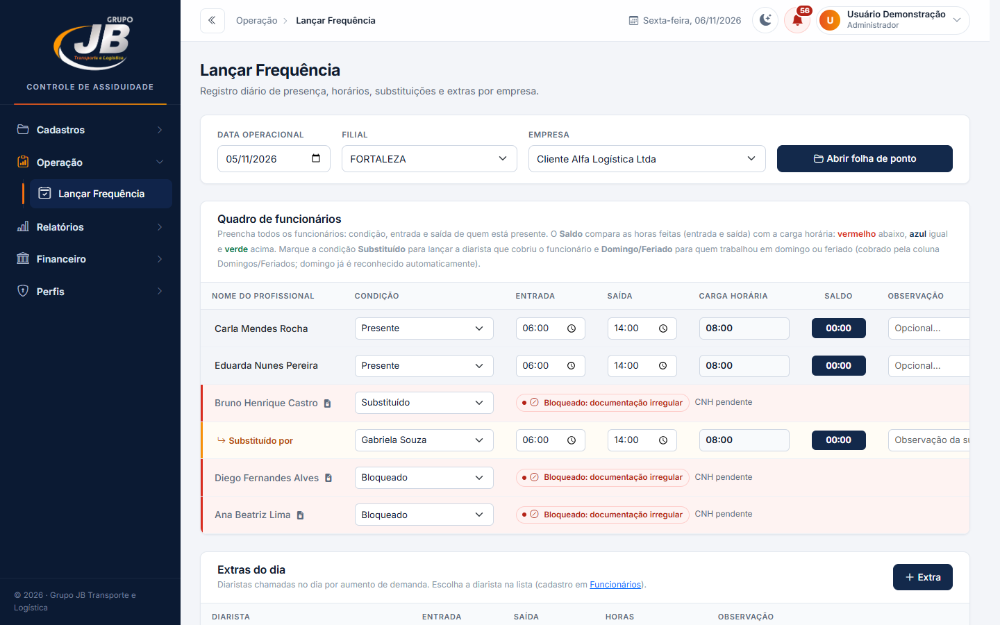
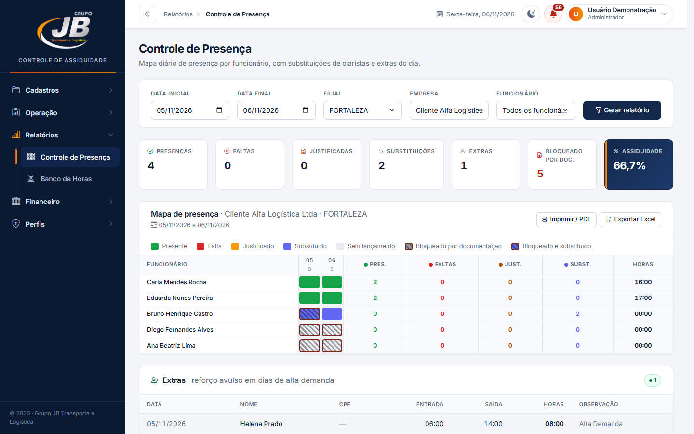
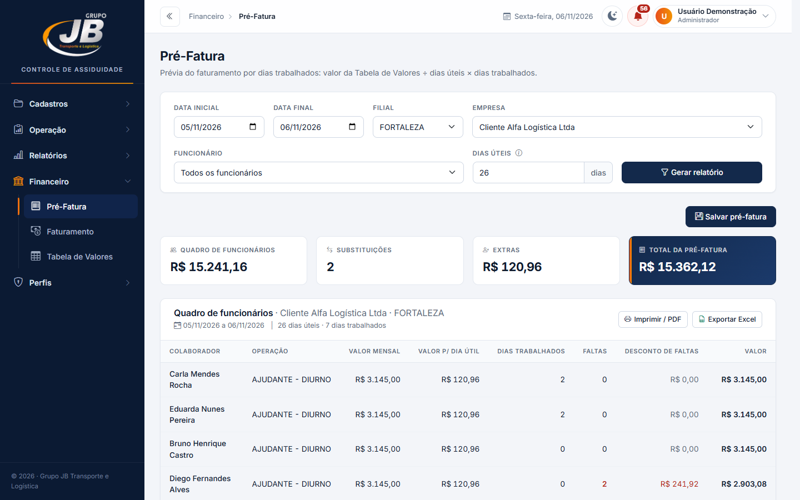
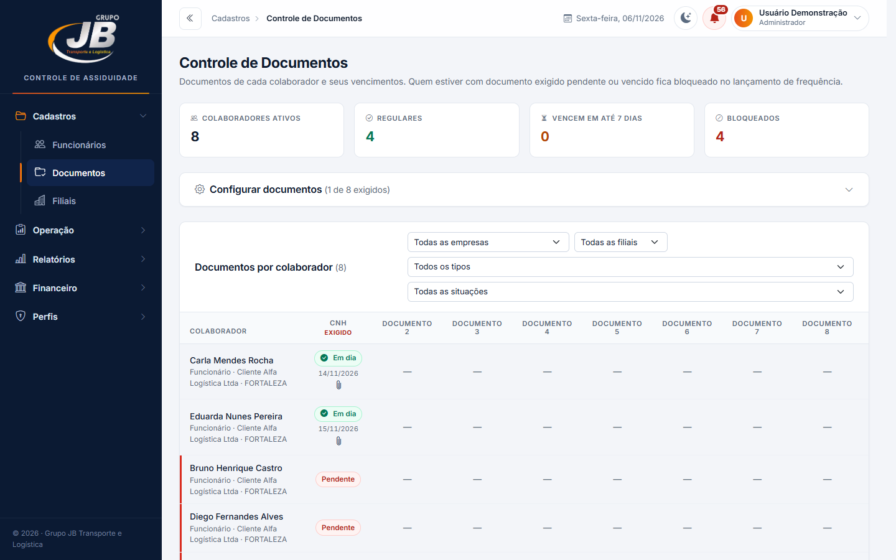
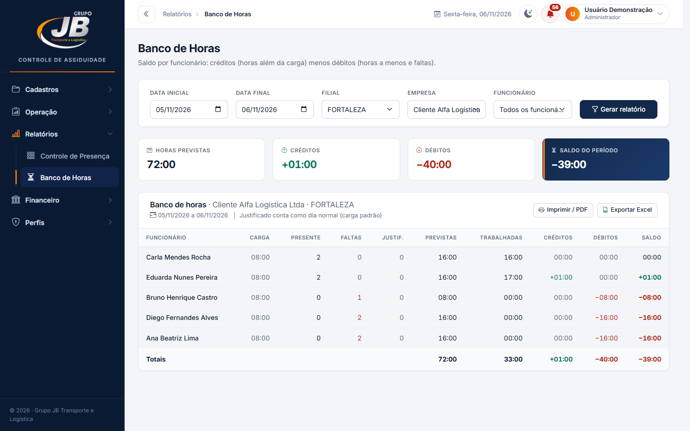
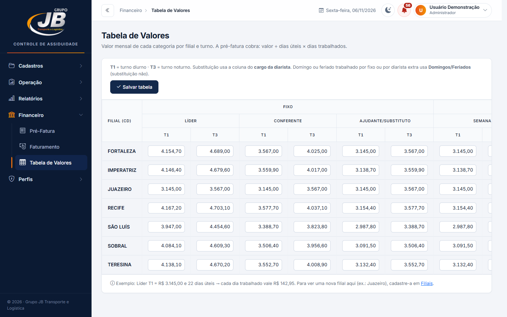
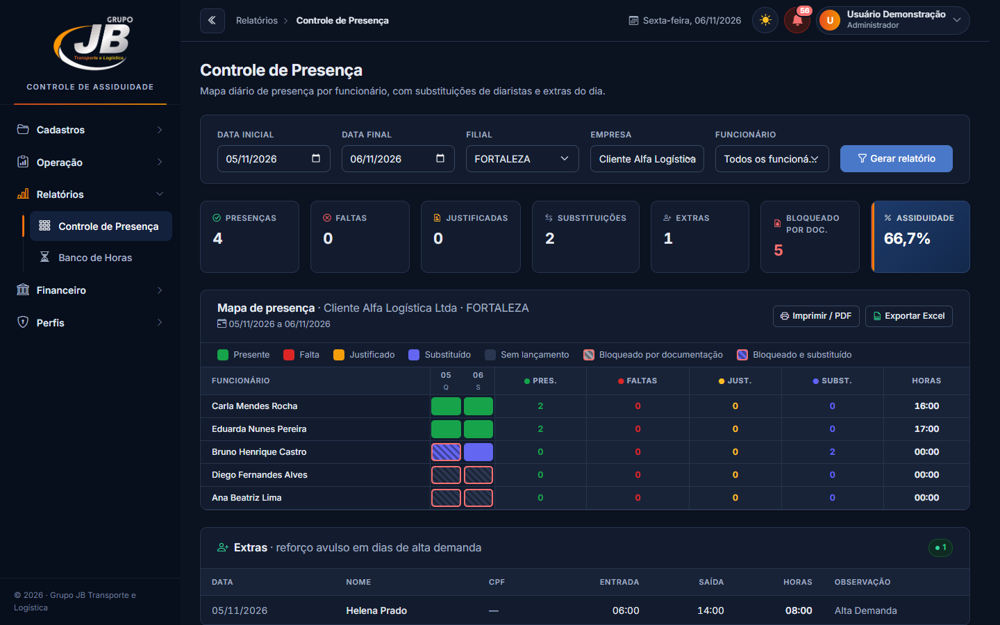

# Controle de Assiduidade · Grupo JB

Sistema web para controlar a frequência diária dos colaboradores terceirizados, a documentação exigida e o faturamento aos clientes.

## O que o sistema faz

- **Cadastros:** empresas clientes (razão social e CNPJ), funcionários e diaristas (cargo, turno, empresa e filial), filiais e usuários.
- **Documentos:** validade e anexos dos documentos de cada colaborador. Quem está com documento pendente ou vencido fica bloqueado na frequência.
- **Lançar Frequência:** folha diária por empresa e filial (Presente, Domingo/Feriado, Falta, Justificado, Substituído por diarista, Bloqueado) e extras do dia.
- **Relatórios:** Controle de Presença (mapa por dia) e Banco de Horas.
- **Financeiro:** Tabela de Valores (filial × cargo × turno), Pré-Fatura por dias trabalhados e histórico de faturas salvas.
- **Perfis:** Administrador, Recursos Humanos, Supervisão, Gestão e Financeiro, cada um com o seu acesso.
- Modo dia e modo noite, impressão em PDF e exportação para Excel.

## Telas

> Prints com dados fictícios (nomes de pessoas e empresas trocados).

### Lançar Frequência
Folha diária por empresa e filial: condição de cada colaborador, horários, saldo de horas, substituição por diarista e bloqueio por documentação.

### Controle de Presença
Mapa do período por funcionário, com indicadores e legenda de cores.

### Pré-Fatura
Cálculo do valor de cada funcionário pela Tabela de Valores: valor mensal, valor por dia útil, faltas e descontos.

### Documentos
Situação dos documentos de cada colaborador: em dia, vencendo ou bloqueado.

### Banco de Horas
Créditos, débitos e saldo por funcionário no período.

### Tabela de Valores
Valor mensal por filial, cargo e turno, usado na pré-fatura.

### Modo noite
Tema escuro, escolhido no botão da barra superior.

## Tecnologias

PHP 8.2, MySQL/MariaDB (PDO), Bootstrap 5.3 e Bootstrap Icons. Pensado para rodar no XAMPP.

## Como instalar

1. Copie a pasta do projeto para `C:\xampp\htdocs\assiduidade_jb`.
2. No phpMyAdmin (ou no terminal), crie o banco `assiduidade_db` e importe `database/schema.sql`.
3. Ajuste usuário e senha do banco em `conexao.php`, se forem diferentes do padrão do XAMPP (`root`, sem senha).
4. Acesse `http://localhost/assiduidade_jb`. No primeiro acesso, o sistema pede para criar o usuário administrador.

As colunas e tabelas novas são criadas automaticamente por `conexao.php` ao abrir o sistema.

## Observações

- Os anexos dos documentos ficam em `uploads/documentos/`, protegidos pelo `uploads/.htaccess`, e não vão para o repositório.
- `database/schema.sql` tem só a estrutura do banco, sem dados.
